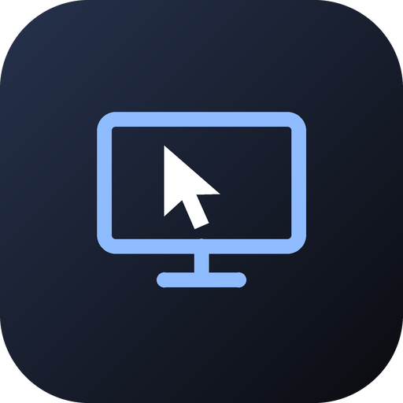

<p align="center">
  
</p>

<h1 align="center">UR Screen</h1>

<p align="center">
  Visor de escritorio remoto para Android que habla directamente el protocolo TCP del servidor de
  <b>Unified Remote</b> (puerto 9800), con su remote <code>Unified.Screen</code>. Siempre en horizontal.
</p>

<p align="center">
  <a href="https://github.com/alexwing/URScreen/actions/workflows/ci.yml"></a>
  <a href="https://github.com/alexwing/URScreen/releases/latest"></a>
  <a href="LICENSE"></a>
</p>

> Proyecto independiente: no está afiliado ni respaldado por Unified Software. Usa el protocolo de su servidor, que
> no está documentado oficialmente; se dedujo observando el tráfico y la interfaz web del propio servidor.

## Descarga

Los APK firmados están en [Releases](https://github.com/alexwing/URScreen/releases/latest) (`URScreen-vX.Y.Z.apk`, con
su suma `.sha256`). Hay que permitir la instalación de apps desconocidas para el navegador o el gestor de ficheros que
se use. Requiere Android 8.0 (API 26) o superior y el servidor de Unified Remote en el PC.

## Qué hace

1. Abre un socket TCP al puerto 9800 del PC.
2. Handshake, autenticación (sin contraseña, con contraseña, o con usuario y contraseña) y carga de `Unified.Screen`.
3. Bucle de fotogramas con 2 peticiones en vuelo: el servidor captura el siguiente mientras el anterior viaja.
4. Gestos sobre la imagen:
   - un dedo, toque: clic izquierdo; quieto 2 s: clic derecho;
   - dos dedos: zoom (pellizco) y desplazamiento de la vista (hasta 6x); sin zoom, arrastrar los dos dedos en
     vertical hace la rueda del ratón;
   - tres dedos, arrastrar en vertical: rueda también (en Xiaomi/HyperOS el sistema los usa para capturar la pantalla).
5. Teclado español flotante (botón «Teclado»): se arrastra por su barra de título, puede salirse de la pantalla, es
   semitransparente con el fondo difuminado. Cada tecla se pulsa al apoyar el dedo y se suelta al levantarlo, así
   que se puede **mantener** una tecla (Windows la repite sola) o mantener Mayús con un dedo y pulsar otra con otro.
   Doble toque rápido sobre un modificador (Mayús, Ctrl, Alt, Win, AltGr) lo deja fijado hasta el siguiente toque.
   Al cerrar el teclado, pasar la app a segundo plano o salir, se sueltan todas las teclas.
6. Barra de controles de solo iconos (selector de pantalla si el PC tiene más de un monitor, teclado, salir), centrada
   y pegada arriba, en pantalla completa. Se mueve agarrándola por el asa de la izquierda (puntos y fps).
   El Intro del teclado es una sola tecla en forma de L, como en un teclado ISO.
7. Al abrir, prueba la conexión con lo guardado (dirección, puerto, usuario y contraseña); si es correcta entra directamente
   al escritorio y, si no, deja el formulario relleno con el motivo. Tras «Salir» no se vuelve a conectar solo.

## Seguridad

- **La contraseña se guarda cifrada** con AES-256-GCM; la clave vive en el Android Keystore y no sale del dispositivo
  (`security/`). Solo se recuerda una contraseña que el servidor ha aceptado; dejar el campo vacío y conectar la borra.
  No se incluye en copias de seguridad ni en el estado guardado de la actividad.
- A la red no sale la contraseña, sino su prueba: SHA-256 de `nonce del servidor + contraseña + nonce del cliente` (con
  usuario, `nonce del servidor + usuario + ":" + contraseña + nonce del cliente`), la misma fórmula que la interfaz web del
  servidor.
- **El tráfico del protocolo no va cifrado**: las pantallas y las teclas viajan en claro por la red. Úsala solo en una red
  de confianza (tu LAN) o a través de una VPN.

## Compilar

Hace falta JDK 17 y el SDK de Android (compileSdk 35).

```
./gradlew assembleDebug        # APK de depuración en app/build/outputs/apk/debug
./gradlew testDebugUnitTest    # pruebas
```

## Publicar una release

Las releases las crea GitHub Actions (`.github/workflows/release.yml`) al subir una etiqueta `v*`:

```
git tag v1.0.1
git push origin v1.0.1
```

El flujo ejecuta las pruebas, compila `assembleRelease` firmado, comprueba la firma con `apksigner` y publica
`URScreen-v1.0.1.apk` y su `.sha256` con las notas generadas. La clave de firma NO está en el repositorio: el flujo la lee
de estos secretos del repositorio (Settings → Secrets and variables → Actions):

| Secreto | Contenido |
| --- | --- |
| `URSCREEN_KEYSTORE_BASE64` | el `.jks` de firma, en Base64 |
| `URSCREEN_KEYSTORE_PASSWORD` | contraseña del almacén |
| `URSCREEN_KEY_ALIAS` | alias de la clave |
| `URSCREEN_KEY_PASSWORD` | contraseña de la clave |

Para firmar en local, define `URSCREEN_KEYSTORE_FILE`, `URSCREEN_KEYSTORE_PASSWORD`, `URSCREEN_KEY_ALIAS` y
`URSCREEN_KEY_PASSWORD` y ejecuta `./gradlew assembleRelease`. La versión sale de `-PversionName=` y `-PversionCode=`.

**Importante:** hay que conservar siempre la misma clave de firma; si se pierde, Android no dejará actualizar la app
instalada con una versión firmada con otra.

## Estructura

```
app/src/main/java/com/alexwing/urscreen/
  protocol/UrValue.kt      tipos del formato binario + DSL para armar paquetes
  protocol/UrCodec.kt      codificar/decodificar paquetes (sin Android, probado con paquetes reales)
  protocol/UrMessages.kt   mensajes del cliente (handshake, update, MoveTo, Click, KeyDown, Vert...) y fotogramas
  net/UrConnection.kt      socket y framing por longitud
  net/UrSession.kt         handshake, autenticación, carga y bucle de fotogramas
  net/FramePacer.kt        ritmo de peticiones: se frena con la pantalla quieta, vuelve a tope con la actividad
  security/                contraseña cifrada: SecretBox (AES-GCM), KeystoreKey, CredentialStore
  ui/ViewerViewModel.kt    estado, conexión automática, decodificado JPEG, cola ordenada de entrada, teclas, monitor
  ui/ViewerScreen.kt       formulario de conexión y visor (Compose)
  ui/ControlBar.kt         barra de iconos movible (pantalla, teclado, salir)
  ui/RemoteGestures.kt     reconocimiento de gestos (toque, pulsación larga, 2 y 3 dedos)
  ui/ViewTransform.kt      zoom y desplazamiento de la vista (lógica pura)
  ui/TapMapper.kt          toque -> coordenadas del escritorio
  ui/ScrollAccumulator.kt  arrastre en píxeles -> pasos de rueda
  ui/FloatingKeyboard.kt   teclado flotante con fondo esmerilado
  ui/KeyboardLayout.kt     distribución del teclado español y nombres de tecla del servidor
  ui/KeyboardController.kt teclado -> PC, con el fijado de modificadores (KeyLatch)
  ui/BackdropMapper.kt     trozo del fotograma bajo el teclado (para el difuminado)
  ui/WindowOffset.kt       límites al arrastrar la ventana del teclado y la barra
tools/                     scripts de PowerShell: medir los objetos GDI del servidor y subir su límite
```

## Lo que se sabe del servidor (comprobado contra uno real)

Las acciones van a `Core.Input` como `MoveTo`, `Click`, `MouseDown/Up`, `Vert`, `KeyDown/Up`; los valores van por
posición. Sus efectos, medidos con una ventana de prueba que registra todo lo que recibe:

- `KeyDown` mantiene la tecla pulsada hasta `KeyUp` y Windows la autorrepite. Los nombres de tecla no distinguen
  mayúsculas: letras `a`-`z`, dígitos `0`-`9`, `return`, `back`, `tab`, `space`, `esc`, flechas, `home`, `end`,
  `delete`, `insert`, `pageup`, `pagedown`, `lshift`/`lctrl`/`lalt`/`ralt`, `capital` (alterna Bloq Mayús), `f1`-`f12`,
  y las `oem_*` que dependen de la distribución del PC (en español: `oem_5` º, `oem_4` ', `oem_6` ¡, `oem_1` `,
  `oem_plus` +, `oem_3` ñ, `oem_7` ´, `oem_2` ç, `oem_102` <, `oem_comma`, `oem_period`, `oem_minus`). `lwin` está en la
  tabla de nombres del servidor pero no se ejercitó (abriría el menú Inicio); F13-F24 no producen señal. Las teclas que
  manda el servidor **no** llevan la marca de «inyectado» de Windows.
- **Si se corta la conexión con una tecla pulsada, el servidor no la suelta**: sigue repitiéndose en el PC hasta que
  otra conexión manda `KeyUp`. La app lo guarda y las suelta nada más reconectar; mientras tanto la tecla sigue pulsada.
- `Click`/`MouseDown`/`MouseUp` aceptan `Left`, `Right`, `Middle` (da igual la mayúscula).
- `Vert(n)` mueve la rueda `n` pasos de 120; positivo sube.
- Con N monitores, `monitor` en `update` y `Display` en `MoveTo` van de 0 a N-1; **pedir un monitor que no existe deja
  la conexión sin respuesta**. Las coordenadas son relativas a cada monitor (el origen del fotograma siempre es 0,0).
  El número de monitores llega en un paquete `monitors` (`Index`) al cargar el remote.
- Los parámetros `x`, `y`, `w`, `h` y `update` de `update` se ignoran: siempre llega el monitor entero.
- **El servidor pierde un objeto GDI por cada fotograma que sirve** (`libs.screen.capture`, código nativo): medido con
  `GetGuiResources` sobre `RemoteServerWin`, crece 1,0 por fotograma, no baja al cerrar las sesiones y solo se libera
  reiniciando el servidor. Windows limita cada proceso a 10.000 objetos, así que a 20 fps el servidor se queda sin
  ellos en unos 8 minutos de streaming y la pantalla se cuelga (otros remotes siguen funcionando) hasta reiniciarlo
  desde su panel. Con la app oficial, a 1-2 fps, tardaría más de una hora en pasar. Por eso la app pide menos
  fotogramas cuando la pantalla no cambia (`FramePacer`: espera hasta 400 ms si los JPEG se repiten, ritmo máximo
  durante 2 s tras cualquier toque o tecla) y no pide ninguno con la app en segundo plano.
  Cerrar el socket de golpe con peticiones en vuelo, o dejar de leer sin cerrar, **no** cuelga el servidor (probado
  con `LiveStressTest`). Para ganar margen se puede subir `GDIProcessHandleQuota` en el registro de Windows hasta 65536
  (requiere administrador y reiniciar): `tools/subir-limite-gdi.ps1`; `tools/medir-gdi-unified.ps1` muestra cuánto
  queda.

## Formato del paquete

```
[longitud: 4 bytes big-endian = bytes que siguen]  [00 01]  [campo]... [00]
campo = [tipo][clave\0][valor]
  02 objeto   03 entero 4 B   04 booleano   05 texto\0   06 lista   07 binario (long. 4 B + datos)   08 byte
```

Las acciones son las mismas que en la interfaz web: 0 Handshake, 1 Authenticate, 3 Load, 5 State,
7 Action, 10 Hash. El detalle está en los comentarios de `UrCodec`.

## Pruebas

```
./gradlew testDebugUnitTest
```

`UrCodecTest` usa paquetes reales capturados de la app oficial (`UrFixtures.kt`, con el nombre del equipo, el identificador
del cliente y la dirección MAC sustituidos por valores de ejemplo): decodifica y recodifica byte a byte, y comprueba que
los mensajes del cliente salen idénticos.

`LiveServerTest`, `LiveInputTest` y `LiveStressTest` hablan con un servidor real y no se ejecutan sin `UR_LIVE_HOST`
(las que inyectan teclas o ratón necesitan además una ventana de prueba que absorba la entrada; ver sus comentarios):

```
$env:UR_LIVE_HOST = "127.0.0.1"
./gradlew testDebugUnitTest --tests "*LiveServerTest*"
```

## Pendiente

- Arrastre con un dedo (hoy no hace nada), teclas multimedia, otras distribuciones de teclado.
- La autenticación con contraseña sigue la fórmula de la interfaz web del servidor, está fijada con pruebas con valores
  calculados aparte y se ha verificado en vivo contra un servidor con contraseña (el log del servidor la da por buena:
  «authenticated without encryption»); el modo «usuarios» no se ha probado contra un servidor.
- Reducir latencia: decodificar el JPEG con `inBitmap` y reutilizar buffers.
- Reconexión automática y `KeepAlive`.

## Licencia

[MIT](LICENSE)
